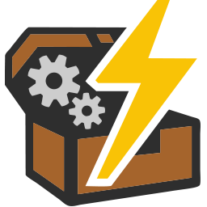

<p align="center">
  
</p>

<h1 align="center">Trueno Modpack</h1>

<p align="center">
  Instalador de escritorio para los modpacks de Minecraft de el_trueno.<br>
  Descarga, actualiza, verifica y deja el perfil listo en el launcher oficial.
</p>

<p align="center">
  <a href="https://github.com/eltrueno/TruenoModpackClient/releases/latest"></a>
  
  <a href="https://github.com/eltrueno/TruenoModpackClient/actions/workflows/release.yml"></a>
  
</p>

---

## Qué hace

- **Instala el modpack con un clic.** Descarga en paralelo solo los archivos que faltan o han cambiado y comprueba el hash de cada uno.
- **Lo mantiene al día.** Al abrir la app compara tu instalación con la última versión y actualiza únicamente las diferencias.
- **Verifica y repara.** Detecta archivos que faltan, corruptos u obsoletos y los vuelve a dejar bien.
- **Prepara el launcher oficial.** Instala el loader (Fabric), crea el perfil con la memoria que elijas y abre el launcher de Minecraft.
- **Respeta tu configuración.** Copia tu `options.txt` la primera vez y no pisa los archivos de configuración que hayas editado.
- **Se actualiza sola** en Windows y en Linux (paquetes `.deb` y `.rpm`); en macOS avisa cuando hay versión nueva.

## Descarga

Todo está en la página de [**Releases**](https://github.com/eltrueno/TruenoModpackClient/releases/latest).

| Sistema | Archivo | Notas |
|---|---|---|
| **Windows** | `TruenoModpackSetup.exe` | Instalador. Windows puede mostrar un aviso de SmartScreen la primera vez. |
| **Linux** (Debian, Ubuntu…) | `truenomodpackclient_<versión>_amd64.deb` | `sudo apt install ./truenomodpackclient_*.deb` |
| **Linux** (Fedora, openSUSE…) | `truenomodpackclient-<versión>-1.x86_64.rpm` | `sudo dnf install ./truenomodpackclient-*.rpm` |
| **macOS** Apple Silicon | `Trueno-Modpack-macOS-arm64-<versión>.dmg` | La app no está firmada: [cómo abrirla](docs/build/macos/MAC_USERS_README.txt). |
| **macOS** Intel | `Trueno-Modpack-macOS-x64-<versión>.dmg` | Igual que la anterior. |

Necesitas tener instalado el **launcher oficial de Minecraft** y haberlo abierto al menos una vez.

### Actualizaciones de la app

| Sistema | Cómo se actualiza |
|---|---|
| Windows | Automáticamente al abrir la app. |
| Linux instalado desde `.deb` / `.rpm` | Automáticamente; el sistema pide tu contraseña para instalar el paquete nuevo. |
| Linux sin paquete, macOS | La app avisa de que hay versión nueva y abre la página de descarga. |

## Desarrollo

Requisitos: **Node.js 20** y npm.

```sh
npm install
npm start
```

| Comando | Qué hace |
|---|---|
| `npm start` | Arranca la app en modo desarrollo con recarga en caliente. |
| `npm run package` | Empaqueta la app para tu sistema en `out/`. |
| `npm run make` | Genera los instaladores de tu sistema en `out/make/`. |
| `npm run check:core` | Comprueba que `src/core` no depende de Electron. |

Guías de build por plataforma: [Linux](docs/build/linux/README_LINUX_BUILD.md) · [macOS](docs/build/macos/README_MAC_BUILD.md)

### Arquitectura

La lógica de la aplicación está separada del framework para que no dependa de Electron:

```
src/
├── core/        Lógica pura (Node): modpacks, Minecraft, descargas, config, actualizaciones
├── electron/    Integración con Electron: ventana, handlers IPC, actualizador, logs
├── shared/      Contrato IPC (nombres de canales) compartido por main y preload
├── renderer/    Interfaz en Vue 3 + Tailwind + daisyUI
├── main.js      Punto de entrada: conecta core y electron
└── preload.js   Puente seguro entre la interfaz y el proceso principal
```

La regla es simple: **nada dentro de `src/core` importa `electron`**. Lo comprueba `npm run check:core`, que también se ejecuta en cada build de CI. Más detalle en [docs/ARCHITECTURE.md](docs/ARCHITECTURE.md).

### Publicar una versión

1. Sube la versión en `package.json` y haz commit en `main`.
2. Crea y sube un tag con ese mismo número, **sin prefijo `v`**:

   ```sh
   git tag 0.6.5
   git push origin 0.6.5
   ```

El workflow [`release.yml`](.github/workflows/release.yml) compila en Windows, Linux y macOS y publica la release con todos los archivos. Los pull requests contra `main` también se compilan en las tres plataformas, sin publicar nada.

Secrets del repositorio que usa el workflow (todos opcionales):

| Secret | Para qué |
|---|---|
| `WINDOWS_CERTIFICATE_PFX_BASE64` | Certificado `.pfx` en base64 para firmar el instalador de Windows. |
| `WINDOWS_CERTIFICATE_PASSWORD` | Contraseña del certificado, si tiene. |
| `APPLE_IDENTITY`, `APPLE_ID`, `APPLE_APP_SPECIFIC_PASSWORD`, `APPLE_TEAM_ID` | Firma y notarización en macOS. |

## Dónde guarda las cosas

| Qué | Windows | Linux | macOS |
|---|---|---|---|
| Datos de la app | `%APPDATA%\Trueno Modpack` | `~/.config/Trueno Modpack` | `~/Library/Application Support/Trueno Modpack` |

Dentro de esa carpeta: `modpack/<id>/minecraftdata/` es la carpeta de juego del modpack, `config.json` son tus preferencias y `logs/main.log` es el registro para diagnosticar problemas.

## Licencia

[MIT](https://opensource.org/license/mit) · Desarrollado con ❤️ por [el_trueno](https://github.com/eltrueno)
